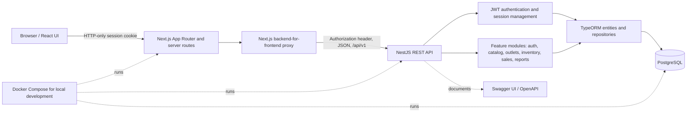
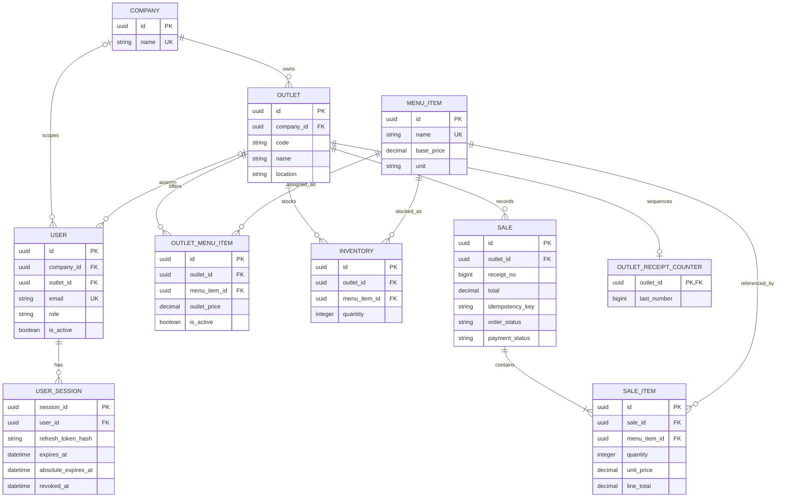

# Architecture Documentation

This document describes the current HQ Management implementation. Scaling,
microservices, and offline POS/KDS recommendations are proposals, not claims
that those capabilities are already deployed. See the separate
[Scaling Plan](./scaling-plan.md) for the full workload and evolution strategy.

## Technology and system context

- **Web application:** Next.js App Router with React, served at port `3000`.
- **Backend API:** NestJS REST API (using the Express platform adapter), served
  at port `3001`, with URI versioning under `/api/v1`.
- **Persistence:** PostgreSQL 17 accessed with TypeORM and explicit migrations.
- **API reference:** Swagger UI at `/api-docs`; the route summary is in
  [API_ENDPOINTS.md](./API_ENDPOINTS.md).
- **Local orchestration:** Docker Compose starts PostgreSQL, API, and web app.
  Compose and Dockerfiles are development/local setup, not evidence of a
  production deployment.



### Request, authentication, and data flow

1. A user interacts with Next.js pages/components. Browser requests to the
   backend route are handled by the Next.js server-side proxy.
2. The proxy reads HTTP-only session cookies, attaches the API access token,
   forwards the request to NestJS, and refreshes the session when appropriate.
   The login route calls the API and writes the session cookies.
3. NestJS applies request validation, authentication/role guards, feature
   services, response handling, and exception handling before TypeORM accesses
   PostgreSQL.
4. The UI uses shared API client functions and React Query for data fetching
   and mutation state.

The API validates environment variables at startup, uses DTO-based validation,
and defines a global response interceptor and exception filters. Access to
features is both role- and tenant-scoped in the backend; hiding a UI control is
not the authorization boundary.

## Repository structure

```text
.
├── apps/
│   ├── api/
│   │   ├── src/
│   │   │   ├── modules/       # Nest controllers, services, DTOs, feature tests
│   │   │   ├── database/      # TypeORM entities, migrations, seeds
│   │   │   ├── common/        # Guards, filters, pipes, DTOs, shared utilities
│   │   │   ├── config/        # Environment validation/configuration
│   │   │   ├── app.module.ts
│   │   │   └── main.ts        # Bootstrap, validation, Swagger, global handling
│   │   ├── Dockerfile
│   │   └── package.json
│   └── web/
│       ├── app/               # App Router pages, layouts, and server routes
│       ├── components/        # Dashboard, POS, reports, and reusable UI
│       ├── lib/
│       │   ├── api/           # API client and typed feature requests
│       │   ├── auth/          # Cookie/session and role helpers
│       │   └── validations/   # Client-side schemas
│       ├── Dockerfile
│       └── package.json
├── docs/                      # API, architecture, scaling, and client docs
├── .husky/                    # Git hooks
├── commitlint.config.mjs
├── docker-compose.yml
└── Makefile
```

### API layering

Each NestJS feature module groups controllers, services, and DTOs. Controllers
define HTTP routes and role/API metadata; services implement business rules and
use TypeORM repositories or transaction managers for data access. This is a
layered modular monolith; there is not a separate repository class for every
entity. Shared guards, decorators, validation, exception handling, and response
formatting live under `apps/api/src/common`.

### Web application responsibilities

Next.js App Router pages and layouts compose the UI. Feature components render
the dashboard, outlet/menu management, POS, sales, and reporting experiences.
Typed functions under `apps/web/lib/api` communicate with the same-origin
backend proxy, while `apps/web/lib/auth` and the server route handlers manage
session cookies and API token forwarding.

## Data model and relationships



### Tenant boundaries and business rules

- A company owns multiple outlets. Company and outlet users are associated
  through `users.company_id` and `users.outlet_id`; backend services scope
  company administrators to their company and outlet roles to their outlet.
- The master `menu_items` catalog is **shared globally**, as confirmed for this
  project. It has no `company_id`. `outlet_menu_items` controls which items
  each outlet offers, whether the assignment is active, and an optional
  outlet-specific price override.
- Inventory is keyed by outlet and menu item. Database constraints prohibit
  negative quantities. Sale creation locks inventory rows and deducts stock
  within a database transaction.
- A sale belongs to one outlet; its line items store `unit_price` and
  `line_total` at sale time. This snapshot preserves historical amounts if a
  menu price changes later.
- Receipt counters are per outlet. An atomic counter update and unique
  `(outlet_id, receipt_no)` constraint protect receipt uniqueness during
  concurrent requests. `(outlet_id, idempotency_key)` protects sale retries.
- Foreign keys and unique/check constraints enforce important relations and
  invariants. Indexes support outlet/date sales lookups, status filtering,
  outlet/menu assignment lookups, and session/user queries.

## Operational and delivery notes

- `docker-compose.yml` and the per-app Dockerfiles support the repository's
  local development workflow. See [README setup](../README.md#run-locally-with-docker-compose).
- API detail and interactive schemas: `/api-docs`; concise route list:
  [API endpoints](./API_ENDPOINTS.md).
- Commit messages are checked by the Husky `commit-msg` hook using Commitlint
  and Conventional Commits; details and examples are in the README.
- The separate [Scaling Plan](./scaling-plan.md) describes the requested
  transaction volume, reporting, infrastructure, microservices, and offline
  POS/KDS evolution.
